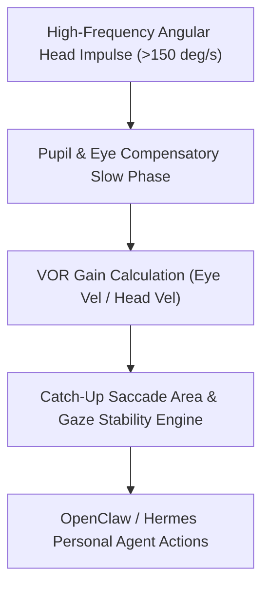

# Video Head Impulse Test (vHIT) & Vestibular Gain Skill

[](LICENSE)
[](https://www.python.org/)
[](requirements.txt)
[](mcp_server.py)
[](SKILL.md)

Zero-dependency sovereign personal agent skill for non-invasive evaluation of video Head Impulse Test (vHIT) angular vestibulo-ocular reflex (VOR) gain, overt/covert saccade quantification, and gaze stability.



## Features
- **Deterministic Math**: Pure Python standard library implementation with zero external dependencies.
- **Clinical Neuro-Otology Standards**: Implements validated algorithms for high-frequency angular canal excitation.
- **Dynamic Visual Acuity & Motion Sickness Stratification**: Direct quantification of retinal slip and vestibular compensation.
- **Model Context Protocol (MCP)**: Native JSON-RPC tool integration for LLMs and autonomous agents.

## Quickstart

```python
from client import VestibularHeadImpulseClient

client = VestibularHeadImpulseClient()
result = client.evaluate_vhit(
    head_velocity_deg_s=195.0,
    eye_velocity_deg_s=188.0,
    overt_saccades_count=0
)
print("VOR Gain:", result["vor_gain"])
print("Classification:", result["classification"])
```

## License
Apache-2.0
